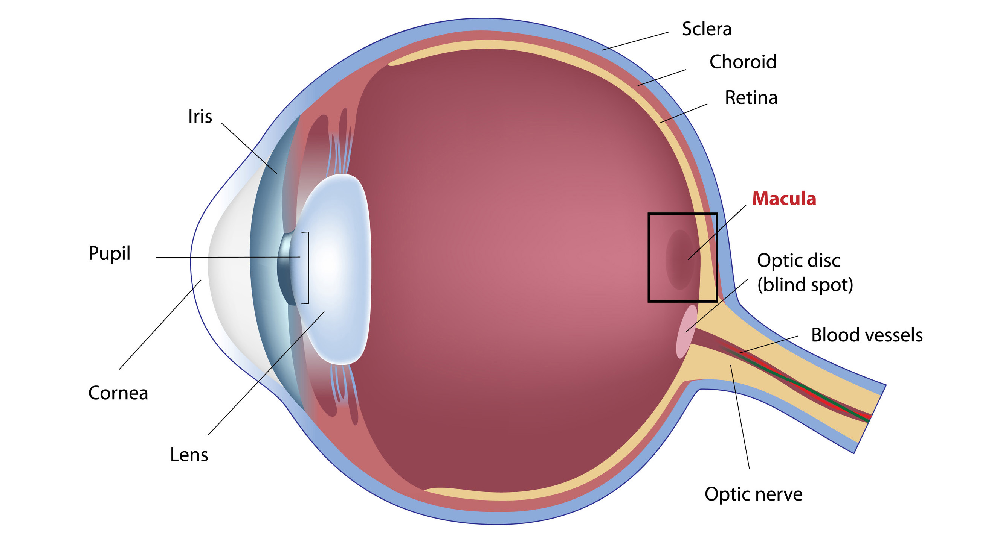

# Introduction

Age Related Macular Degeneration (AMD) is an eye disease that can blur central vision. It happens when aging causes damage to the macula, located at the center of the retina and crucial for high-resolution color vision. The macula has a complex anatomical structure supports a dense array of cone photoreceptors and specialized neuronal pathways essential for central vision \[1\]\[2\].

AMD is a common condition, it’s a leading cause of vision loss for older adults. AMD doesn’t cause complete blindness, but losing your central vision can make it harder to see. In addition to age, AMD risk is increased with smoking, being caucasian and moreover, it has one of the strongest genetic components of any complex medical disease \[1\]\[3\].

Given its genetic relvance, there has been a lot of genetic efforts to identify associated genes. Large genome-wide association studies have identified over 30 genes associated with the risk of developing AMD. Being one of the most important cluster the complement cascade con chromosome 1, and the *ARMS2/HTRA* genes con chromosome 10.



Against this backdrop, the aim is to use the public PennCath data which arises from a Genome-wide association (GWA) study of coronary artery disease (CAD) and cardiovascular risk factors based at the University of Pennsylvania Medical Center to identidy associated genes with AMD.

## Lab 1: Understanding the data and additional settings:

First, initial configurations were made related with printing or not messages and also the directories to save the `.rds`

```{r}
knitr::opts_chunk$set(echo = TRUE)
knitr::opts_chunk$set(message = TRUE)
knitr::opts_chunk$set(warning = TRUE)

# Save .rds
knitr::opts_knit$set(root.dir = "/home/jcontreras/LCG/3rdyear/Statistics/GWAS/GWAS/Rdata/")

#Remove any data objects or functions to avoid collisions or misspecification
rm(list=ls())
```

Now, we are going to download `Biocmanager v.3.23` and `snpStats`, relevant libraries to analyze data

```{r}
if (!requireNamespace("BiocManager", quietly = TRUE))
  install.packages("BiocManager")
BiocManager::install(version = "3.23")
BiocManager::install("snpStats")
```

Subsequently, we loded the libaries and fixed colors to mantain consisntence with plots: lightblue for single variable plots, and dark red for thresholds

```{r}
library(snpStats)
library(ggplot2)

# Consistent look for all ggplot2 figures: minimal theme, light blue for single-variable plots, red for thresholds
theme_set(theme_minimal())
lightBlue <- "lightblue"
darkBlue <- "#08519C"
thresholdColour <- "firebrick"
```

### Understanding the data 

The first step in any statistical analysis is to understand the data your working with. No analysis is useful if the data formats and meanings are misunderstood. Genetic data is complex in that it is not just a simple .csv file that can be read into R. Instead, genotype array data are often organized into either (1) .ped and .map files or (2) .bim, .bed and .fam files.

Increasingly, sequencing data is organized in .vcf file formats, which is another topic. R can be used to read in either set of file types (utilizing external packages), though the second set of files is substantially smaller and thus generally preferable. In this lab, we describe and explore the elements of the .bim, .bed and .fam files, as well as show how these files can be read into R for analysis.

The idea if these files it’s just that, collectively thet can represent a matriz of the type $G_\text{nxm}$, where $n$ is the number of individuals and $m$ the SNPs. Each file contains diferent information, including:

- **Binary PED file (.bed)**: Stores the genotypes in a binary way. For example, can have: 0 if it's the reference allele, 1 if there is one alternative copy and 2 if there is two.

- **Variant Information (.bim):** Contain information of each genetic variant. It usually has 6 columns:

  - Chromosome

  - SNP ID

  - Genetic distance (cM)

  - Physical position

  - Allele 1

  - Allele 2

- Family Information (.fam): Contain information of the analyzed individuals. Here you can find your relevant phenotype.

# References

1.  Koksaldi S, Kayabasi M, Karti O, Saatci AO. *Clinical anatomy of the macula*. Med Hypothesis Discov Innov Ophthalmol. 2025 Jul 31;14(2):17-27. doi: 10.51329/mehdiophthal1520. PMID: 40787281; PMCID: PMC12330045.
2.  National Eye Insitute. *Age-Related Macular Degeneration (AMD)*. National Institutes of Health (NIH). 2021 June 22. <https://www.nei.nih.gov/eye-health-information/eye-conditions-and-diseases/age-related-macular-degeneration>
3.  [Reena Mukamal](https://www.linkedin.com/in/reena-mukamal-2736a05/) *Genetics and Age-Related Macular Degeneration*. American Academy Of Ophtalmology. <https://www.aao.org/eye-health/diseases/age-related-macular-degeneration-amd-genetics>
